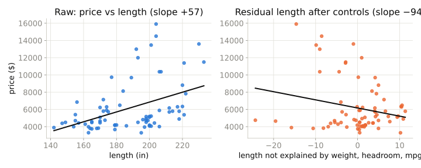
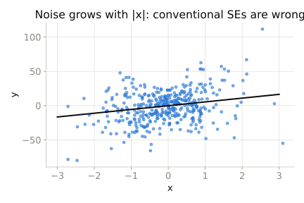

## The series

- Nine one-hour sessions, one research design each
- Read the chapter first; we replicate and discuss
- Every walkthrough in Python **and** R
- Predict before you run

::: {.notes}
Set expectations: this is a study group, not a lecture. The value is in the replication and the argument about assumptions.
:::

## The problem in one diagram

```{dot}
//| fig-width: 9
//| fig-height: 3.2
digraph {
graph [rankdir=LR, bgcolor="transparent", fontname="Helvetica"]; node [shape=box, style="rounded,filled", fillcolor="#eef4f9", color="#1f5f8b", fontname="Helvetica", fontsize=16]; edge [color="#52514e", penwidth=1.6];
  Price -> Quantity [label="  what you want", color="#2a78d6", penwidth=2.5, fontcolor="#2a78d6"];
  Demand [label="demand shocks\n(income, tastes)", fillcolor="#fff8e6", color="#8a6d1d"];
  Supply [label="supply shocks\n(weather, costs)", fillcolor="#fff8e6", color="#8a6d1d"];
  Demand -> Price; Demand -> Quantity; Supply -> Price; Supply -> Quantity;
}
```

::: {.small}
Every observed (price, quantity) pair was produced by *both* kinds of shock. The regression of quantity on price mixes the blue arrow with everything else.
:::

## Correlation is not causation — but *why* not?

- People, firms and governments **optimize**
- Observed outcomes are the result of choices made with information we do not see
- So the treatment is correlated with everything that drove the choice
- "Optimization makes everything endogenous"

## Price elasticity of demand

- Every observed (price, quantity) is an equilibrium: supply *and* demand moved
- Regress $Q$ on $P$ and you get… a mix of both curves
- Philip Wright (1928): find something that shifts supply only (weather)
- That is the agenda for the whole book: *where does the exogenous variation come from?*

## What a regression coefficient is

- $E[Y \mid X]$ is the conditional expectation function (CEF)
- Regression gives the **best linear approximation** to the CEF, always
- That is a *descriptive* fact. Nothing causal yet.
- Causal content enters only through assumptions about $u$: $E[u \mid X] = 0$

## Regression anatomy (Frisch–Waugh–Lovell)

$$\beta_1 = \frac{\mathrm{Cov}(y, \tilde{x}_1)}{\mathrm{Var}(\tilde{x}_1)}, \quad \tilde{x}_1 = x_1 - \hat{E}[x_1 \mid x_2, \dots, x_k]$$

- "Controlling for $x_2$" = using only the part of $x_1$ that $x_2$ cannot predict
- Today we reproduce a multiple-regression coefficient this way, by hand

## Regression anatomy, in a picture

{width=100%}

::: {.small}
Same 74 cars. Left: longer cars cost more. Right: once weight, headroom and mpg are taken out of length, the *leftover* length is associated with a *lower* price — and that slope is exactly the multiple-regression coefficient.
:::

## Standard errors

| Situation | Use |
|---|---|
| Errors have constant variance | Conventional |
| Variance depends on $X$ | Heteroskedasticity-robust (HC1) |
| Units share shocks (classrooms, states) | Cluster-robust |

- Changes inference, never the estimate
- Clustering is not a fix for omitted variables

## Why "robust" standard errors exist

::: {.columns}
::: {.column width="55%"}
{width=100%}
:::
::: {.column width="45%"}
- The line is fine
- The *spread* around it changes with $x$
- Conventional SE assumes it doesn't
- Robust SE measures the spread as it is
:::
:::

## Walkthrough

1. `auto`: price on length, then add controls — watch the sign flip
2. Reproduce the `length` coefficient via regression anatomy
3. Simulated heteroskedasticity: conventional vs robust SE
4. Simulated clusters: robust vs clustered SE (and a biased estimate)

## Takeaway

::: {.takeaway}
Regression tells you what the conditional expectation looks like. Whether that is a causal effect depends entirely on an argument about the error term — and that argument is the rest of this book.
:::
