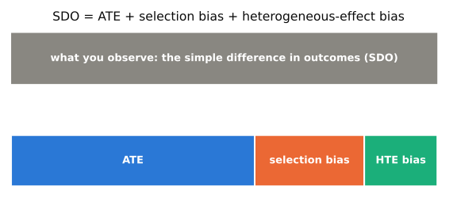
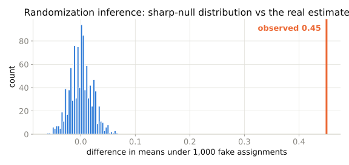

## Last time

- DAGs say which variables to condition on
- Today: the language for *what* we are estimating, and what randomization buys

## Potential outcomes

| unit | $D$ | $Y^1$ | $Y^0$ | observed $Y$ | effect $\delta$ |
|---|---|---|---|---|---|
| Andy | 1 | 10 | **?** | 10 | ? |
| Ben | 1 | 5 | **?** | 5 | ? |
| Edith | 0 | **?** | 5 | 5 | ? |
| Frank | 0 | **?** | 7 | 7 | ? |

- Each person has two possible futures; we see one
- The **?** cells are the fundamental problem of causal inference
- Every design is a way of filling in the **?** credibly

## Estimands

- $ATE = E[\delta]$
- $ATT = E[\delta \mid D = 1]$
- $ATU = E[\delta \mid D = 0]$
- They differ when effects are heterogeneous **and** treatment is selected on them

## The decomposition

$$\underbrace{E[Y \mid D=1] - E[Y \mid D=0]}_{\text{SDO}} = ATE + \underbrace{E[Y^0 \mid D=1] - E[Y^0 \mid D=0]}_{\text{selection bias}} + \underbrace{(1-\pi)(ATT - ATU)}_{\text{HTE bias}}$$

- Selection bias: the treated would have done differently anyway
- HTE bias: the treated gain differently from treatment
- Every design in this book is a story about killing these two terms

## The decomposition, as a picture

{width=95%}

::: {.small}
Randomization sets the orange and aqua pieces to zero on average. Every other design is an argument for why they are zero anyway.
:::

## Randomization

- $D \perp (Y^0, Y^1)$
- Both bias terms are zero in expectation
- SDO = ATE
- The regression is doing no work; the design did it

## Randomization inference

- Fisher's **sharp null**: $\delta_i = 0$ for every $i$
- Under it, every missing potential outcome is known
- Recompute the statistic for every possible assignment
- Exact $p$-value, no distributional assumptions, no large-sample appeal

## What randomization inference looks like

{width=90%}

::: {.small}
Reshuffle who was "treated" 1,000 times; the blue histogram is what a zero effect produces. The real estimate (orange) is nowhere near it.
:::

## Walkthrough

1. Yule (1899): pauperism on out-relief — regression without a design
2. Thornton (2008): randomized HIV-test incentives in Malawi
3. Fisher's exact $p$ on 8 units (70 assignments)
4. RI on Thornton with 1,000 permutations

## Takeaway

::: {.takeaway}
Write the SDO decomposition on the wall and keep it there for the rest of the series. Randomization zeroes both bias terms; everything else is an argument about why they might be zero anyway.
:::
