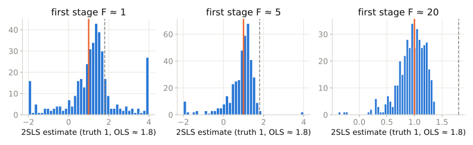

## Last time

- A fuzzy RD: treatment *probability* jumps at the cutoff
- Effect = jump in $Y$ / jump in $D$
- That is an IV. Today: any variable can play the cutoff's role

## The problem, and the trick

```{dot}
//| fig-width: 10
//| fig-height: 3
digraph {
graph [rankdir=LR, bgcolor="transparent", fontname="Helvetica"]; node [shape=box, style="rounded,filled", fillcolor="#eef4f9", color="#1f5f8b", fontname="Helvetica", fontsize=16]; edge [color="#52514e", penwidth=1.6];
  Z [label="instrument Z\n(near a college)", fillcolor="#e3f4e9", color="#1f5f3a"]; D [label="treatment D\n(schooling)"]; Y [label="outcome Y\n(wages)"];
  u [label="unobserved u\n(ability)", fillcolor="#fff8e6", color="#8a6d1d"];
  Z -> D [label=" first stage", color="#1f5f3a", penwidth=2.5, fontcolor="#1f5f3a"]; D -> Y [label=" δ  (what we want)", color="#2a78d6", penwidth=2.5, fontcolor="#2a78d6"];
  u -> D; u -> Y; Z -> u [style=invis]; Z -> Y [style=dashed, color="#e34948", label=" must NOT exist\n (exclusion)", fontcolor="#e34948"];
}
```

$$\delta_{IV} = \frac{\text{effect of } Z \text{ on } Y}{\text{effect of } Z \text{ on } D} = \frac{\text{reduced form}}{\text{first stage}}$$

## Three conditions (plus one)

| Condition | Meaning | Testable? |
|---|---|---|
| Relevance | $Z$ predicts $D$ | Yes — first-stage F |
| Exclusion | $Z \to Y$ only through $D$ | No |
| Independence | $Z$ as good as random w.r.t. $u$ | No |
| Monotonicity | No defiers | No |

## 2SLS

1. Regress $D$ on $Z$ and covariates; keep $\hat{D}$
2. Regress $Y$ on $\hat{D}$ and the same covariates
3. Use an IV routine for the SEs — two `lm` calls get them wrong

## Weak instruments

{width=100%}

::: {.small}
Truth is 1 (orange); naive OLS gives 1.8 (grey). With a weak first stage, 2SLS is spread everywhere *and* pulled toward the OLS answer. Rule of thumb: first-stage F above 10; nervous below 20.
:::

## LATE

- With heterogeneous effects, IV identifies the effect for **compliers**: units whose $D$ is moved by $Z$
- Different instruments → different compliers → different LATEs
- Card's compliers: people for whom college distance was binding
- Stevenson's compliers: defendants detained by a strict judge, released by a lenient one

## Walkthrough

1. Card: OLS return to schooling ≈ 0.07
2. First stage (0.33) and reduced form (0.04) by hand → Wald ≈ 0.12
3. 2SLS with proper SEs
4. Judge leniency: OLS 0.035 vs 2SLS 0.16

## Takeaway

::: {.takeaway}
IV is reduced form over first stage. Relevance you can test; exclusion you must argue; and the answer is a LATE for whoever the instrument moves.
:::
