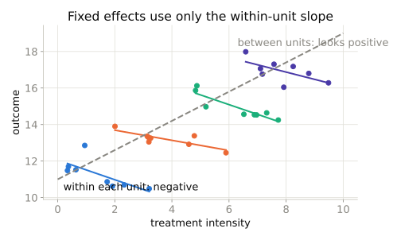
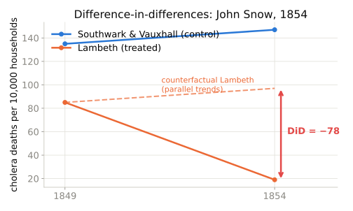

## Last time

- IV: exogenous variation from an instrument, in a cross-section
- Today: exogenous variation from **within-unit change over time**

## The fixed-effects model

$$Y_{it} = \delta D_{it} + \mathbf{X}_{it}\beta + u_i + \varepsilon_{it}$$

- $u_i$: everything about unit $i$ that does not change
- It can be correlated with $D_{it}$ however it likes
- FE compares each unit **to itself**

## Within vs between

{width=80%}

::: {.small}
Four units, each observed eight times. Across units the relationship looks positive; within every unit it is negative. Fixed effects keep only the within slopes — by unit dummies, by demeaning, or by differencing, all equivalent.
:::

## What FE needs

- **Strict exogeneity**: $E[\varepsilon_{it} \mid D_{i1}, \dots, D_{iT}, u_i] = 0$
- Time-varying unobservables that move with $D$: still a problem
- Feedback (today's shock → tomorrow's treatment): a problem
- Regressors that never change within unit: absorbed, gone

## The SASP question

- Sex workers charge more for unprotected sex. Compensating differential, or selection?
- Panel: same provider, many clients
- Pooled OLS: premium ≈ 0. Within provider: ≈ 5%.

## The 2×2 DiD

$$\hat{\delta} = (\bar{Y}_{T,post} - \bar{Y}_{T,pre}) - (\bar{Y}_{C,post} - \bar{Y}_{C,pre})$$

- As a regression: $Y = \alpha + \beta\,\text{Treat} + \gamma\,\text{Post} + \delta\,(\text{Treat} \times \text{Post}) + e$
- Assumption: **parallel trends** — a counterfactual claim, untestable in the 2×2

## John Snow, 1854

{width=80%}

::: {.small}
The dashed line is the assumption: without the move upstream, Lambeth would have risen by the same +12 as Southwark & Vauxhall. The effect is the gap between that line and what happened.
:::

## Walkthrough

1. SASP pooled OLS
2. FE three ways
3. Why they differ: within vs between
4. Snow by hand and by regression; draw the counterfactual

## Takeaway

::: {.takeaway}
Fixed effects remove what is fixed. The 2×2 DiD is a two-unit, two-period fixed-effects model whose identifying assumption — parallel trends — you cannot test until you have more than two of something.
:::
