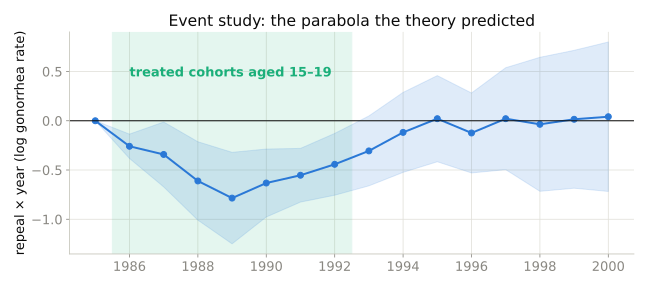
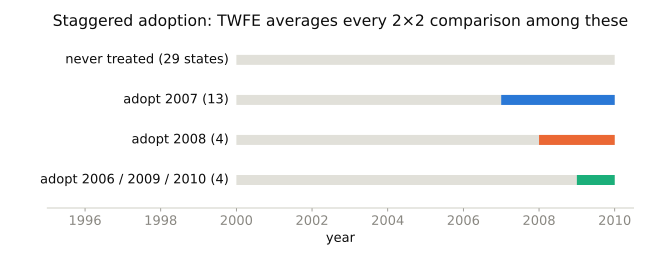
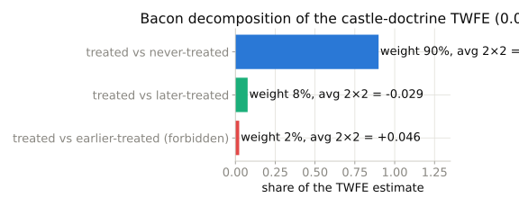

## Last time

- The 2×2: no standard errors, no test of parallel trends
- Today: many periods, many groups — and a new problem

## Event studies

{width=95%}

::: {.small}
One coefficient per year relative to 1985. Flat before 1986 (nothing was happening yet); a parabola during the years the treated cohorts were 15–19; back to zero after.
:::

## Placebos and triple differences

- If theory says the effect exists only for a group / cohort / window, estimate it where it *should not* and demand zero
- DDD: subtract the placebo group's DD from the treated group's DD
- Absorbs group-specific shocks a plain DD would call "treatment"

## Abortion legalization (Cunningham & Cornwell 2013)

- Five states repealed bans in 1970; *Roe* in 1973
- Treated cohorts: born 1971–73 in repeal states
- Prediction: lower gonorrhea among 15–19 year olds in 1986–92, tracing a **parabola** as the cohort ages through the bracket
- Placebo: 25–29 year olds

## Staggered adoption

{width=100%}

- TWFE: $Y_{it} = \alpha_i + \lambda_t + \delta D_{it} + e_{it}$
- Goodman-Bacon: $\hat{\delta}$ is a weighted average of **every** 2×2 among these groups — including late-treated vs *already-treated*

## What the decomposition shows

{width=95%}

::: {.small}
Here the forbidden comparisons carry 2% of the weight, so TWFE is safe. With no never-treated states, that share can dominate.
:::

## Modern estimators

- **Callaway–Sant'Anna**: ATT for each cohort × period, using only never- or not-yet-treated controls; aggregate with chosen weights
- **Sun–Abraham**: the same idea inside an interaction-weighted event-study regression
- Both need a clean control group; neither is magic

## Castle doctrine (Cheng & Hoekstra 2013)

- "Stand your ground" laws, 2005–2010, 21 states
- TWFE: log homicide up ≈ 8%
- 29 never-treated states → the decomposition puts 90% of weight on clean comparisons

## Walkthrough

1. Abortion event study: the parabola
2. Placebo cohort and DDD
3. Castle TWFE
4. Bacon decomposition by hand; a modern estimator

## Takeaway

::: {.takeaway}
The event-study plot is the deliverable. TWFE is a weighted average with weights you did not choose; decompose it, and if the forbidden comparisons carry weight, use an estimator that refuses to make them.
:::
