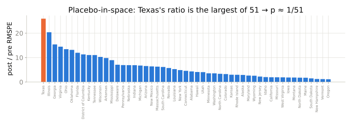
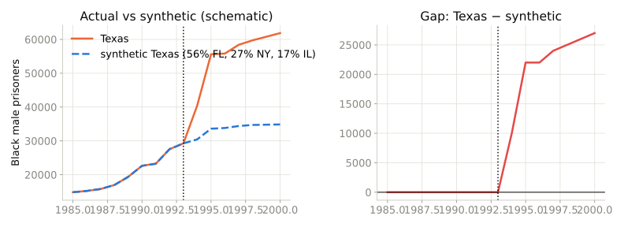

## Last time

- DiD needs a control group whose trend you trust
- With one treated unit and a few candidates, you are picking a control by hand
- Today: let an algorithm build the control

## The synthetic-control estimator

- Donors $j = 1, \dots, J$; weights $w_j \geq 0$, $\sum_j w_j = 1$
- Choose $w$ so the weighted donors match the treated unit's **pre-period** outcomes and predictors
- Effect = post-period gap between treated and synthetic

## Why the constraints matter

- Non-negative, sum to one → stay inside the convex hull of donors
- No extrapolation
- Sparse, interpretable weights: "Texas is 45% California, 32% Ohio…"
- Bad pre-period fit = nothing to say. Report the pre-RMSPE.

## Inference by placebo

{width=100%}

::: {.small}
Pretend each other state was treated, build its synthetic twin, and compute how much worse the fit got after 1993. Texas is the most extreme of 51 → rank-based $p ≈ 0.02$.
:::

## Texas (Cunningham & Kang 2019)

{width=100%}

::: {.small}
Prison construction 1993–94. Synthetic Texas tracks real Texas before, then falls ≈ 23,000 Black male prisoners per year behind.
:::

## Walkthrough

1. Fit the synthetic Texas; read the weights
2. Plot actual vs synthetic; the gap
3. Placebo-in-space; Texas's rank
4. Then: the design decision tree

## Which design, when

```{dot}
//| fig-width: 13
//| fig-height: 5.8
digraph {
graph [rankdir=LR, bgcolor="transparent", fontname="Helvetica", nodesep=0.35, ranksep=1.2]; node [shape=box, style="rounded,filled", fontname="Helvetica", fontsize=20, fillcolor="#eef4f9", color="#1f5f8b"]; edge [color="#52514e", fontname="Helvetica", fontsize=12];
  q [label="What decided who\ngot treated?", fillcolor="#fff8e6", color="#8a6d1d"];
  r [label="a coin flip"]; o [label="observed traits\n(you can list them all)"]; c [label="a cutoff rule"]; i [label="something exogenous\nthat nudges treatment"]; t [label="a change over time\nwithin units"]; a [label="one big unit changed,\nothers did not"];
  q -> r; q -> o; q -> c; q -> i; q -> t; q -> a;
  r -> R [label=""]; R [label="compare means\n+ randomization inference", fillcolor="#e3f4e9", color="#1f5f3a"];
  o -> O; O [label="matching / weighting\n(check overlap)", fillcolor="#e3f4e9", color="#1f5f3a"];
  c -> C; C [label="regression discontinuity\n(plot it; density test)", fillcolor="#e3f4e9", color="#1f5f3a"];
  i -> I; I [label="instrumental variables\n(first-stage F; LATE)", fillcolor="#e3f4e9", color="#1f5f3a"];
  t -> T; T [label="fixed effects / DiD\n(event-study leads)", fillcolor="#e3f4e9", color="#1f5f3a"];
  a -> A; A [label="synthetic control\n(pre-fit; placebos)", fillcolor="#e3f4e9", color="#1f5f3a"];
}
```

## Three new questions

1. Did a city minimum-wage ordinance reduce restaurant employment?
2. Does an extra year of schooling raise earnings for students who barely pass an entry test?
3. Do public defenders get longer sentences than private counsel?

For each: estimand, design, assumption as a counterfactual sentence, first diagnostic.

## Takeaway

::: {.takeaway}
The method follows the source of exogenous variation, never the reverse. If you cannot name where the variation comes from, the data cannot answer the causal question — and saying so is a result.
:::

## Where next

- The book's *Mixtape Sessions*
- *Causal Inference for the Brave and True* (Python, free)
- Huntington-Klein, *The Effect* (free; R + Python)
- The staggered-DiD literature: Goodman-Bacon; Callaway & Sant'Anna; Sun & Abraham; Roth et al.
